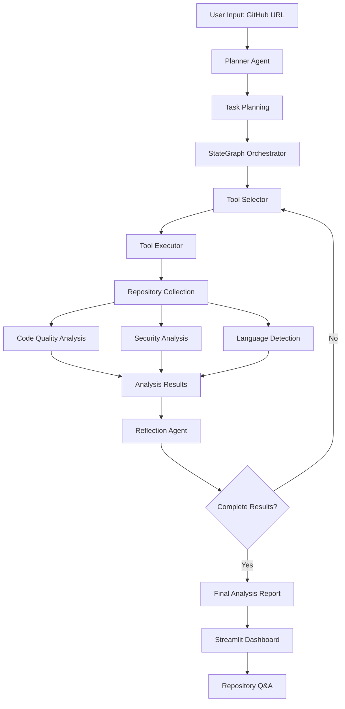

# 🚀 RepoInsight – GitHub Repository Analysis Agent

An AI-inspired, multi-agent GitHub repository analysis system that automatically explores public repositories, analyzes their code quality, identifies potential security issues, and answers questions about repository structure and code.

## 📌 Project Overview

**RepoInsight** is an intelligent GitHub Repository Analysis Agent built using Python and Streamlit.

It follows a structured agent workflow to understand user requests, create an execution plan, select appropriate tools, analyze repository files, and generate a comprehensive report.

The application helps developers understand unfamiliar repositories without manually inspecting every file.

## ✨ Key Features

- **Automated Repository Analysis:** Clone and analyze public GitHub repositories.
- **Repository Exploration:** Collect repository files and understand project structure.
- **Programming Language Detection:** Identify programming languages used in the repository.
- **Code Quality Analysis:** Perform Python AST-based checks and Pyflakes analysis.
- **Security Analysis:** Detect potential security issues using heuristic checks.
- **Agent-Based Workflow:** Break tasks into multiple steps using a planner and orchestrator.
- **Dynamic Tool Selection:** Select and execute tools according to the analysis task.
- **Error Handling & Retry:** Handle transient failures and retry operations.
- **Reflection & Validation:** Review analysis results for completeness.
- **Repository Q&A:** Ask questions about the analyzed repository.
- **Execution Trace:** View agent activities and tool execution history.

## 🏗️ System Architecture

The following diagram represents the RepoInsight workflow:



## 🧠 Agent Workflow

RepoInsight follows a multi-step execution workflow:

1. **Planner Agent:** Understands the user's request and breaks it into smaller tasks.
2. **Tool Selector:** Selects suitable tools for each task.
3. **Tool Executor:** Executes repository collection and analysis operations.
4. **Analyzer Modules:** Perform language, quality, and security analysis.
5. **Reflection Agent:** Checks whether the generated results are sufficiently complete.
6. **StateGraph Orchestrator:** Manages workflow execution and coordinates the agents.
7. **Final Output:** Displays the analysis report and supports repository-related questions.

## 🛠️ Technology Stack

| Category | Technologies |
|---|---|
| Programming Language | Python |
| Frontend | Streamlit |
| Code Analysis | Python AST, Pyflakes |
| Version Control | Git, GitHub |
| Workflow | Agent-based orchestration, StateGraph-style workflow |
| Testing | Pytest |
| Repository Access | Git |

## 📂 Project Structure

```text
RepoInsight/
│
├── agent/
│   ├── agents.py
│   ├── agents_qa.py
│   ├── analyzers.py
│   ├── orchestrator.py
│   ├── quality.py
│   ├── repository.py
│   └── tools.py
│
├── tests/
│   └── test_agent_workflow.py
│
├── app.py
├── requirements.txt
├── .env.example
├── .gitignore
└── README.md
```

## ⚙️ Installation & Setup

### 1. Clone the Repository

```bash
git clone https://github.com/ByteVaish/RepoInsight.git
cd RepoInsight
```

### 2. Create a Virtual Environment

**Windows:**

```bash
python -m venv venv
venv\Scripts\activate
```

**Linux / macOS:**

```bash
python3 -m venv venv
source venv/bin/activate
```

### 3. Install Dependencies

```bash
pip install -r requirements.txt
```

### 4. Run the Application

```bash
streamlit run app.py
```

The application will open in your browser.

## 🖥️ Application Modules

RepoInsight provides the following dashboard sections:

| Module | Description |
|---|---|
| Analyse Repository | Analyze a public GitHub repository |
| Ask Questions | Ask questions about repository analysis |
| Execution Trace | Monitor agent execution steps |
| Tools & History | Explore available tools and execution history |

## 🧪 Testing

Run the test suite using:

```bash
pytest -v
```

## 🎯 Example Use Case

**Input:**

```text
https://github.com/psf/requests
```

**Expected Workflow:**

- Collect repository files.
- Identify programming languages.
- Analyze Python code quality.
- Perform heuristic security checks.
- Generate an analysis report.
- Allow users to ask questions about the repository.

You can also test invalid repository URLs to observe error handling.

## 🔐 Security & Limitations

- Currently supports public GitHub repositories.
- Does not execute the target repository's source code.
- Security findings are heuristic indicators, not confirmed vulnerabilities.
- Detailed code quality checks primarily focus on Python files.
- Analysis results depend on repository accessibility and collected files.

## 🌟 Future Enhancements

- Support for private repositories using secure authentication.
- More advanced vulnerability detection.
- Support for additional programming languages.
- Integration with LLM-powered code explanations.
- Export reports in PDF format.
- Improved analysis performance for large repositories.

## 👩‍💻 Author

GitHub: [@ByteVaish](https://github.com/ByteVaish)

## 📄 License

No license has currently been specified for this repository.
